# TP4 — Architecture microservices avec Spring Cloud : la « Calculatrice »

**Eureka · Spring Cloud Gateway · OpenFeign · Spring Cloud LoadBalancer · Swagger UI (springdoc-openapi) · Lombok**

| | |
|---|---|
| **Établissement** | Faculté des Sciences de Sfax — Département d'informatique et des Communications |
| **Matière** | Architecture MicroServices — filière MPSRCC1 |
| **Enseignantes** | Corinne Amel ZAYANI, Amal ABID |
| **Étudiante** | Amal Karaoud |
| **Année universitaire** | 2026-2027 |
| **Dépôt** | <https://github.com/Amalkaraoud/TP4-MS> (branche `main`) |

---

## Sommaire

1. [Présentation et objectifs](#1-présentation-et-objectifs)
2. [Fondements techniques](#2-fondements-techniques)
3. [Architecture réalisée](#3-architecture-réalisée)
4. [Environnement et technologies](#4-environnement-et-technologies)
5. [Organisation du dépôt](#5-organisation-du-dépôt)
6. [Construction et lancement](#6-construction-et-lancement)
7. [L'annuaire Eureka](#7-lannuaire-eureka-eureka-service)
8. [calcul-service](#8-calcul-service)
9. [historique-service et OpenFeign](#9-historique-service-et-openfeign)
10. [La passerelle : routes statiques](#10-la-passerelle--routes-statiques)
11. [La passerelle : routes dynamiques](#11-la-passerelle--routes-dynamiques)
12. [Swagger UI et OpenAPI](#12-swagger-ui-et-openapi)
13. [Actuator](#13-actuator-observation-des-routes)
14. [Répartition de charge : ce que les captures permettent de conclure](#14-répartition-de-charge--ce-que-les-captures-permettent-de-conclure)
15. [Synthèse des validations](#15-synthèse-des-validations)
16. [Limites et points ouverts](#16-limites-et-points-ouverts)
17. [Réponses aux questions du TP](#17-réponses-aux-questions-du-tp)
18. [Conclusion et perspectives](#18-conclusion-et-perspectives)
19. [Annexe : vue d'ensemble du corpus de captures](#annexe--vue-densemble-du-corpus-de-captures)

---

## 1. Présentation et objectifs

Au TP3, la calculatrice était découpée en deux microservices Spring Boot (`calcul-service`, `historique-service`) communiquant en HTTP. Cette architecture présentait trois faiblesses :

| Faiblesse du TP3 | Réponse apportée par le TP4 |
|---|---|
| L'adresse de `calcul-service` est écrite en dur (`calcul.service.url=http://localhost:8081`). | Découverte de services : appel par **nom** (`CALCUL-SERVICE`) via **Eureka** et **OpenFeign**. |
| Le client doit connaître le port de chaque microservice. | Point d'entrée unique : **Spring Cloud Gateway** (port 8888). |
| Une seule instance de `calcul-service` est jamais appelée. | Plusieurs instances enregistrées dans l'annuaire, choisies par **Spring Cloud LoadBalancer**. |

**Objectifs techniques traités dans ce dépôt**

- Créer un serveur Eureka et y enregistrer des microservices ; lancer deux instances d'un même service (ports 8081 et 8083).
- Remplacer un client `RestClient` à adresse fixe par une interface déclarative OpenFeign.
- Configurer une passerelle en routes statiques (YAML puis Java) et en routes dynamiques issues de l'annuaire.
- Organiser les quatre programmes en modules Maven d'un même projet, sous un `pom.xml` parent.
- Documenter et tester les API avec Swagger UI, et générer le code répétitif des classes de données avec Lombok.

Le corpus de captures qui illustre ce document est présenté en [annexe](#annexe--vue-densemble-du-corpus-de-captures). Les sections 14 et 16 indiquent précisément ce que ces captures démontrent et ce qu'elles ne démontrent pas.

---

## 2. Fondements techniques

| Concept | Principe | Composant utilisé |
|---|---|---|
| **Service registry** | Annuaire où chaque instance s'inscrit au démarrage (nom, hôte, port) et signale périodiquement qu'elle est vivante (*heartbeat*). Une instance silencieuse est évincée. | Eureka Server |
| **Service discovery** | Un client interroge l'annuaire (copie locale rafraîchie périodiquement) pour obtenir les instances d'un service à partir de son nom. | Eureka Client |
| **Répartition de charge côté client** | À partir de la liste d'instances, le client choisit à chaque appel une instance (stratégie par défaut : *round robin*). | Spring Cloud LoadBalancer (schéma `lb://`) |
| **Client REST déclaratif** | Une interface annotée (`@FeignClient`, `@GetMapping`…) dont Spring génère l'implémentation. | OpenFeign |
| **API Gateway** | Point d'entrée unique : une route associe un prédicat (ex. `Path=/calcul/**`), une destination et des filtres facultatifs. Fondée sur WebFlux (serveur Netty, non bloquant). | Spring Cloud Gateway |
| **OpenAPI** | Description normalisée de l'API (`/v3/api-docs`) et page d'essai (`/swagger-ui.html`), générées à partir des contrôleurs. | springdoc-openapi |
| **Génération de code** | Getters, setters et constructeurs produits à la compilation par annotations. | Lombok |

---

## 3. Architecture réalisée

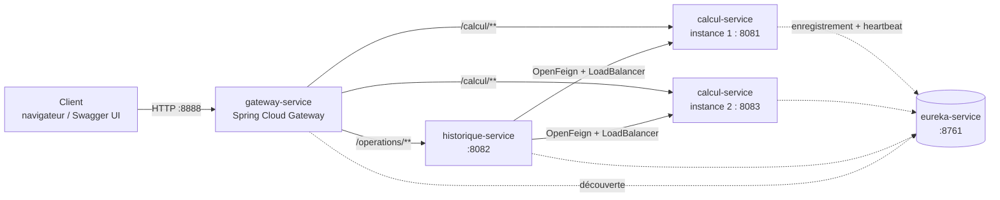

| Programme | Port | Responsabilité |
|---|---|---|
| `eureka-service` | 8761 | Annuaire des services (Eureka Server). |
| `calcul-service` | 8081 et 8083 | Effectue les quatre calculs ; deux instances du **même** programme. |
| `historique-service` | 8082 | Enregistre les opérations (CRUD en mémoire) et appelle `calcul-service` par son nom via OpenFeign. |
| `gateway-service` | 8888 | Point d'entrée unique ; route les requêtes vers les microservices. |

**Chemin d'une requête `POST /operations` vue du client** : client → passerelle (8888) → `historique-service` (8082) → OpenFeign + LoadBalancer → une instance de `calcul-service` (8081 ou 8083) → la réponse remonte le même chemin.

---

## 4. Environnement et technologies

| Élément | Valeur | Source |
|---|---|---|
| JDK | OpenJDK Temurin **17.0.20.1** (bytecode 61.0) | Figures 1 et 11 |
| Git | **2.56.0.windows.2** | Figure 1 |
| Système / IDE | Windows 11, IntelliJ IDEA | Captures |
| Spring Boot | Version 4.0.x imposée par l'énoncé (4.0.9) | `pom.xml` des modules |
| Spring Cloud | Ligne 2025.1.x (compatible Boot 4.0) | `pom.xml` des modules |
| springdoc-openapi | 3.0.x (`webmvc-ui` pour les microservices, `webflux-ui` pour la passerelle) | `pom.xml` des modules |
| Maven | 3.9+ requis par l'énoncé | — |

La version exacte de chaque bibliothèque est celle déclarée dans les `pom.xml` ; la figure 1 ne montre pas la sortie de `mvn -v`.

<p align="center">
  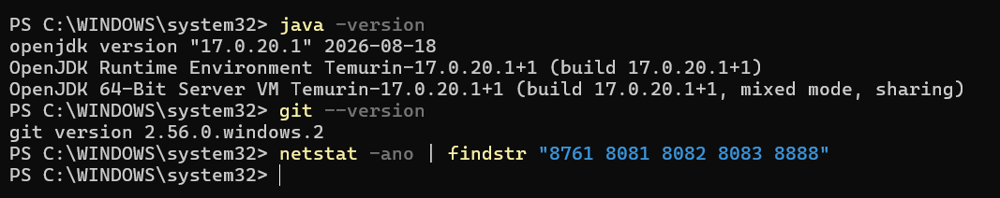<br>
  <em>Figure 1 — Vérification de l'environnement : Java 17 (Temurin), Git 2.56.0 ; la commande <code>netstat</code> filtrant les ports 8761, 8081, 8082, 8083 et 8888 ne renvoie aucune ligne, ce qui indique que ces ports étaient libres avant le lancement.</em>
</p>

---

## 5. Organisation du dépôt

```text
TP4-MS/
├── README.md
├── .gitignore
├── screenshots/                     # captures citées dans ce document
└── calculatrice-spring-cloud/       # projet IntelliJ / pom parent
    ├── pom.xml                      # packaging pom : agrège les modules
    ├── eureka-service/              # annuaire (8761)
    ├── calcul-service/              # calculs (8081 / 8083)
    ├── historique-service/          # historique + OpenFeign (8082)
    └── gateway-service/             # passerelle (8888)
```

Le `pom.xml` racine a `packaging=pom` : il ne produit aucun `.jar` et regroupe les modules ; chaque module conserve son propre `pom.xml` (parent `spring-boot-starter-parent`) et reste une application Spring Boot indépendante, avec sa JVM, son port et son cycle de vie. Regrouper le code ne regroupe pas l'exécution.

<p align="center">
  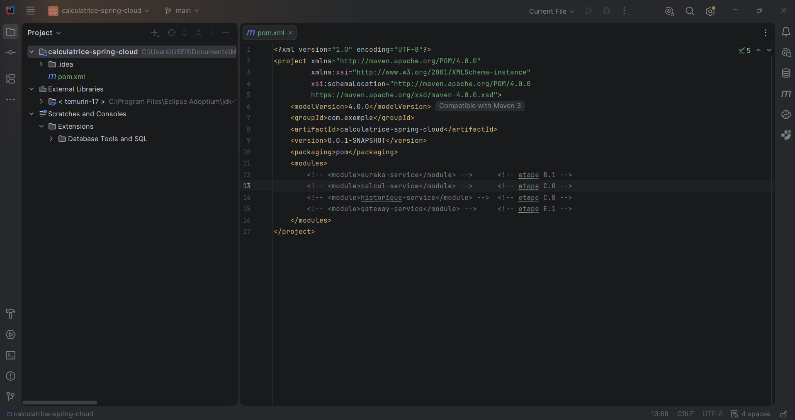<br>
  <em>Figure 2 — État initial du projet <code>calculatrice-spring-cloud</code> : <code>pom.xml</code> parent (<code>groupId</code> <code>com.exemple</code>, <code>packaging</code> pom) dont les quatre modules sont déclarés en commentaire, JDK Temurin 17 associé au projet.</em>
</p>

<p align="center">
  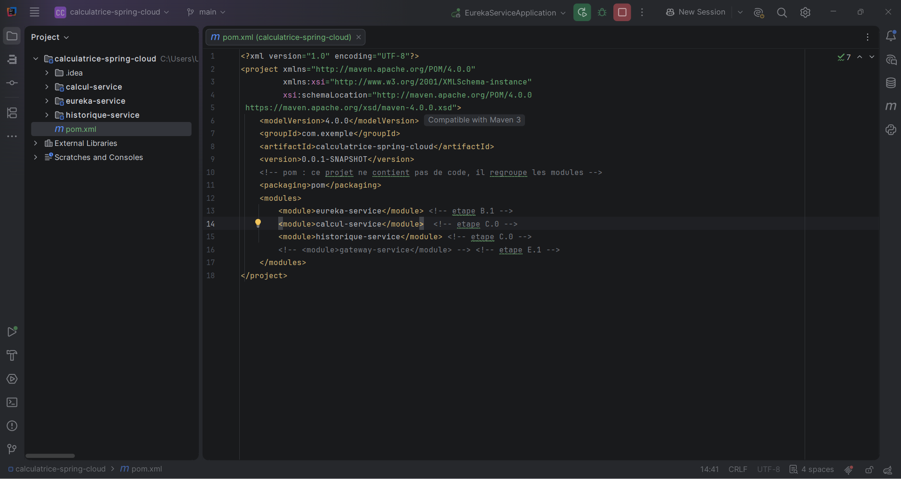<br>
  <em>Figure 3 — Modules activés dans le <code>pom.xml</code> parent : <code>eureka-service</code>, <code>calcul-service</code> et <code>historique-service</code> sont déclarés ; <code>gateway-service</code> reste en commentaire à ce stade (il est ajouté à la partie E). Branche <code>main</code>.</em>
</p>

---

## 6. Construction et lancement

**Prérequis** : JDK 17 ou supérieur, Maven 3.9 ou supérieur (ou le Maven intégré à IntelliJ), ports 8761, 8081, 8082, 8083 et 8888 libres. Aucun outil externe de test n'est nécessaire : toutes les requêtes sont envoyées depuis Swagger UI.

**Construction** (à la racine de `calculatrice-spring-cloud`) :

```powershell
mvn clean package -DskipTests
```

**Ordre de lancement** — l'annuaire d'abord, la passerelle en dernier (un terminal par programme) :

```powershell
java -jar eureka-service\target\eureka-service-0.0.1-SNAPSHOT.jar
java -jar calcul-service\target\calcul-service-0.0.1-SNAPSHOT.jar
java -jar calcul-service\target\calcul-service-0.0.1-SNAPSHOT.jar --server.port=8083
java -jar historique-service\target\historique-service-0.0.1-SNAPSHOT.jar
java -jar gateway-service\target\gateway-service-0.0.1-SNAPSHOT.jar
```

L'option `--server.port=8083` l'emporte sur `application.properties` et permet de lancer la seconde instance du même `.jar`. Sous IntelliJ, la seconde instance correspond à une configuration de lancement copiée avec l'argument de programme `--server.port=8083` (figure 33 : configuration `CalculServiceApplication 8083`).

| Page | URL |
|---|---|
| Tableau de bord Eureka | <http://localhost:8761> |
| Swagger UI de `calcul-service` | <http://localhost:8081/swagger-ui.html> (et `:8083`) |
| Swagger UI de `historique-service` | <http://localhost:8082/swagger-ui.html> |
| Swagger UI de la passerelle | <http://localhost:8888/swagger-ui.html> |
| Routes de la passerelle | <http://localhost:8888/actuator/gateway/routes> |

---

## 7. L'annuaire Eureka (`eureka-service`)

### 7.1 Réalisation

Le module ne contient qu'une annotation particulière, `@EnableEurekaServer`, sur la classe principale :

```java
@SpringBootApplication
@EnableEurekaServer
public class EurekaServiceApplication { /* main */ }
```

```properties
spring.application.name=eureka-service
server.port=8761
# Le serveur EST l'annuaire : il ne s'inscrit pas chez lui-même
eureka.client.register-with-eureka=false
eureka.client.fetch-registry=false
# Réglages d'expérimentation : éviction rapide des instances arrêtées
eureka.server.eviction-interval-timer-in-ms=5000
eureka.server.enable-self-preservation=false
```

Le starter du serveur embarque aussi le client Eureka : sans `register-with-eureka=false` et `fetch-registry=false`, le serveur tenterait de s'inscrire lui-même. La désactivation du mode d'auto-préservation et l'éviction toutes les 5 s rendent les expériences observables en quelques secondes ; **en production, on conserve les valeurs par défaut**, l'auto-préservation protégeant l'annuaire contre une partition réseau.

### 7.2 Validation : annuaire vide

<p align="center">
  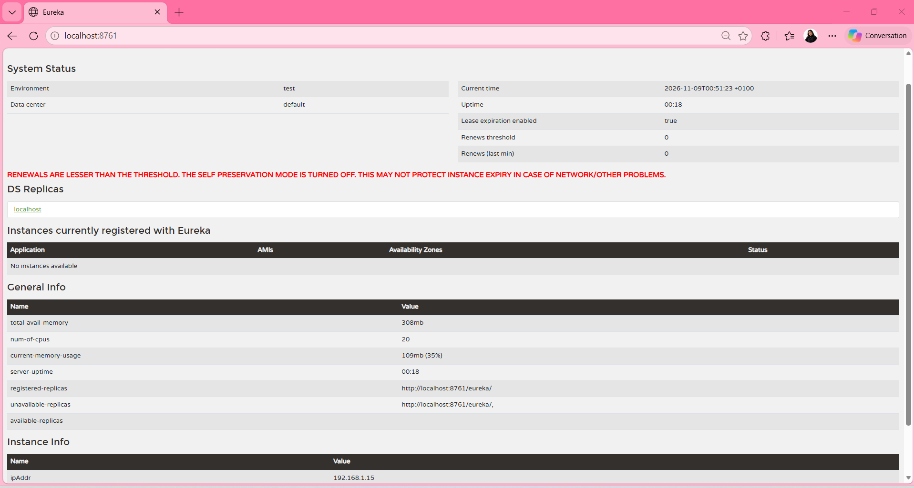<br>
  <em>Figure 4 — Tableau de bord Eureka sur <code>localhost:8761</code> avant toute inscription : « No instances available ». Le bandeau rouge « SELF PRESERVATION MODE IS TURNED OFF » est la conséquence attendue de <code>enable-self-preservation=false</code>. La rubrique <code>registered-replicas</code> affiche l'URL du serveur lui-même (<code>http://localhost:8761/eureka/</code>) : l'annuaire n'est pas répliqué.</em>
</p>

### 7.3 Configuration des clients

Chaque microservice reçoit la dépendance `spring-cloud-starter-netflix-eureka-client` et l'adresse de l'annuaire. Aucune annotation Java n'est requise : l'inscription est automatique.

```properties
spring.application.name=calcul-service          # nom du service dans l'annuaire (affiché CALCUL-SERVICE)
eureka.client.service-url.defaultZone=http://localhost:8761/eureka
eureka.instance.instance-id=${spring.application.name}:${server.port}
eureka.instance.prefer-ip-address=true
eureka.instance.lease-renewal-interval-in-seconds=5      # heartbeat toutes les 5 s (défaut : 30)
eureka.instance.lease-expiration-duration-in-seconds=10  # retrait après 10 s de silence (défaut : 90)
```

Deux informations distinctes décrivent une instance : le **nom** du service (`CALCUL-SERVICE`), commun aux instances et utilisé par les appelants, et l'**identifiant d'instance** (`calcul-service:8081`), qui distingue chaque exemplaire dans la liste.

### 7.4 Validation : inscription, deuxième instance, arrêt

<p align="center">
  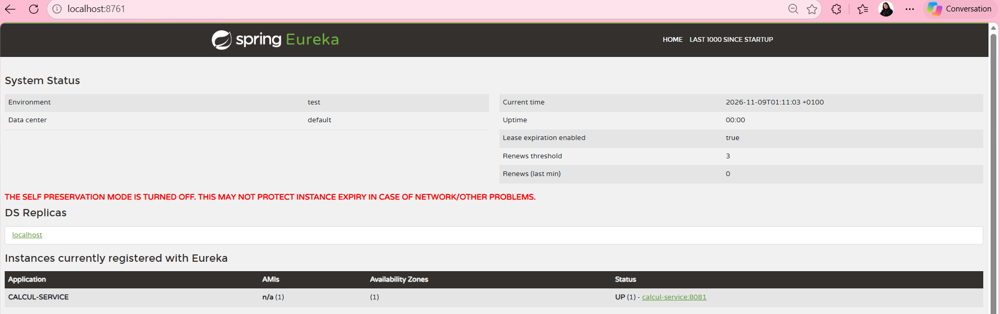<br>
  <em>Figure 5 — Après le démarrage de <code>calcul-service</code> : <code>CALCUL-SERVICE</code> apparaît avec le statut UP (1), une seule instance, sur le port 8081.</em>
</p>

<p align="center">
  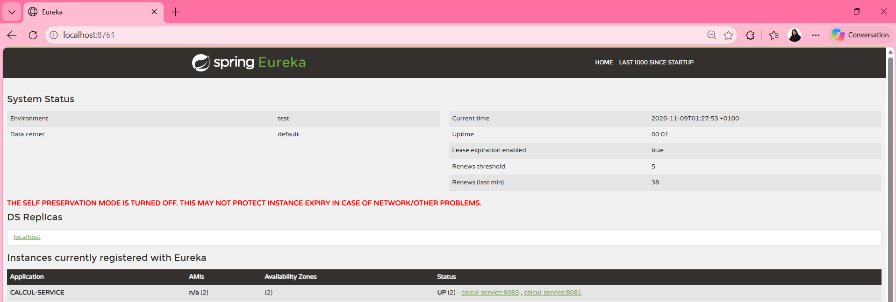<br>
  <em>Figure 6 — Après le lancement de la seconde instance avec <code>--server.port=8083</code> : <code>CALCUL-SERVICE</code> affiche UP (2), avec les instances des ports 8081 et 8083. Même nom de service, identifiants différents.</em>
</p>

<p align="center">
  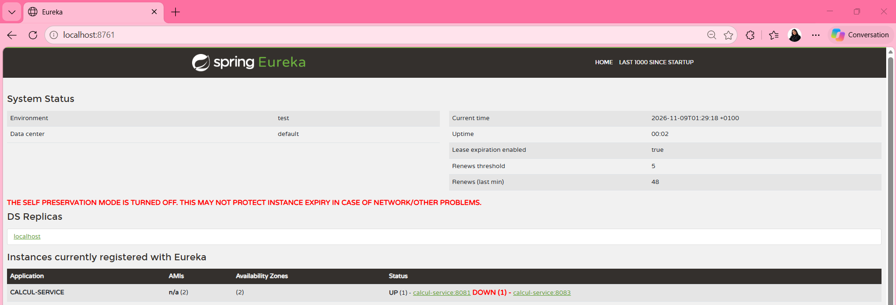<br>
  <em>Figure 7 — Après l'arrêt de l'instance 8083 : l'annuaire signale l'instance 8081 UP et l'instance 8083 DOWN. L'annuaire réagit donc à la disparition d'une instance ; l'instance DOWN n'est plus un candidat valide pour les appelants.</em>
</p>

**Interprétation.** Les figures 5 à 7 valident le cycle de vie d'une instance : inscription au démarrage, coexistence de plusieurs instances sous un même nom, puis changement d'état à l'arrêt. Le retrait définitif d'une instance dont le processus a été tué brutalement dépend de l'expiration du bail (10 s) puis du passage de l'éviction (5 s) ; la figure 7 ne documente que le statut DOWN.

---

## 8. `calcul-service`

### 8.1 Réalisation

Application Spring MVC (Tomcat) exposant les quatre opérations sous `/calcul` :

| Méthode | URI | Paramètres | Réponse |
|---|---|---|---|
| GET | `/calcul/somme` | `a`, `b` (entiers) | `a + b`, en texte brut |
| GET | `/calcul/soustraction` | `a`, `b` | `a − b` |
| GET | `/calcul/produit` | `a`, `b` | `a × b` |
| GET | `/calcul/division` | `a`, `b` | `a ÷ b` ; **400** avec `Erreur : division par 0 impossible` si `b = 0` |
| GET | `/calcul/somme/detail` | `a`, `b` | JSON `{"operation","a","b","resultat"}` (classe `Resultat`) |

**Traçage de l'instance.** Pour identifier quelle instance traite chaque calcul, le contrôleur lit son port dans la configuration et l'affiche :

```java
@Value("${server.port}")
private int port;

@GetMapping(value = "/somme", produces = MediaType.TEXT_PLAIN_VALUE)
public ResponseEntity<String> somme(@RequestParam("a") int a, @RequestParam("b") int b) {
    System.out.println("[calcul-service:" + port + "] somme " + a + "+" + b);
    return ResponseEntity.ok(String.valueOf(calculService.somme(a, b)));
}
```

Cette trace est l'unique moyen, côté serveur, de savoir quelle instance a répondu ; elle sert de base à la [section 14](#14-répartition-de-charge--ce-que-les-captures-permettent-de-conclure).

### 8.2 Validation

<p align="center">
  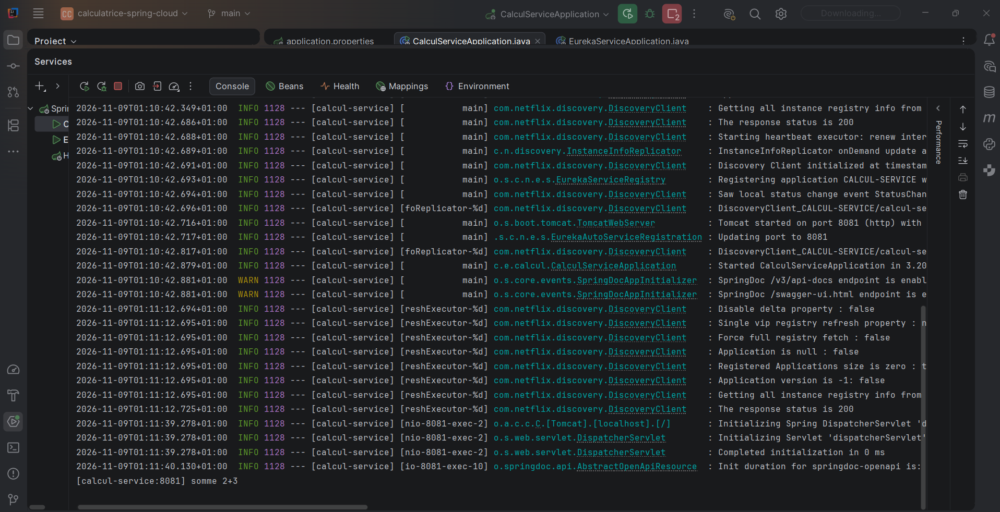<br>
  <em>Figure 8 — Console de <code>calcul-service</code> (instance 8081) : démarrage, enregistrement auprès d'Eureka (<code>DiscoveryClient</code>) et première trace de calcul au format <code>[calcul-service:8081] …</code>.</em>
</p>

<p align="center">
  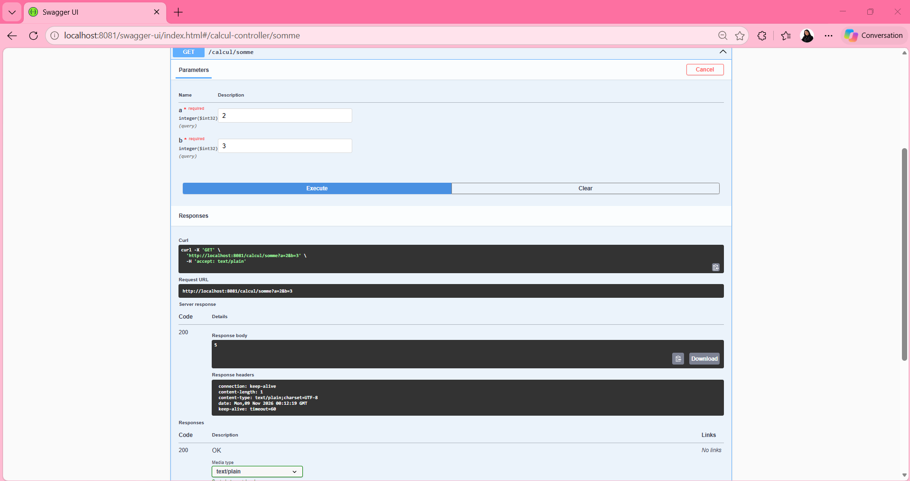<br>
  <em>Figure 9 — Appel direct de <code>GET /calcul/somme</code> depuis Swagger UI de l'instance 8081 : <code>a = 2</code>, <code>b = 3</code>, résultat <strong>5</strong>.</em>
</p>

<p align="center">
  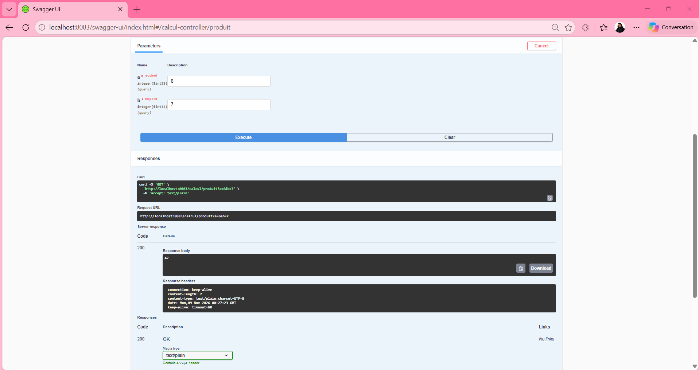<br>
  <em>Figure 10 — Appel direct de <code>GET /calcul/produit</code> sur la seconde instance (port 8083) : 6 × 7 = <strong>42</strong>. La seconde instance est opérationnelle de façon indépendante.</em>
</p>

---

## 9. `historique-service` et OpenFeign

### 9.1 Du `RestClient` à l'interface déclarative

Au TP3, `CalculClient` construisait un `RestClient` sur une adresse lue dans la configuration. Il est remplacé par une interface : OpenFeign en génère l'implémentation au démarrage, et LoadBalancer choisit, à chaque appel, une instance dans la copie locale de l'annuaire.

```java
@SpringBootApplication
@EnableFeignClients
public class HistoriqueServiceApplication { /* main */ }
```

```java
@FeignClient(name = "CALCUL-SERVICE")          // nom du service dans Eureka : plus aucune adresse
public interface CalculClient {

    @GetMapping("/calcul/{operateur}")
    String calculer(@PathVariable("operateur") String operateur,
                    @RequestParam("a") int a,
                    @RequestParam("b") int b);
}
```

Les annotations sont celles de Spring MVC lues « dans l'autre sens » : dans `CalculController`, elles *déclarent* les requêtes reçues ; ici, elles *décrivent* les requêtes envoyées. La propriété `calcul.service.url` du TP3 a disparu.

### 9.2 Gestion des erreurs

Les exceptions de Feign remplacent celles de `RestClient`. L'ordre des blocs `catch` est significatif : la sous-classe d'abord.

```java
try {
    String corps = calculClient.calculer(op.getOperateur(), op.getA(), op.getB());
    op.setResultat(Double.parseDouble(corps));
    return null;
} catch (FeignException.BadRequest e) {            // calcul-service a répondu 400 (division par 0)
    return ResponseEntity.badRequest().body(Map.of("erreur", e.contentUTF8()));
} catch (FeignException e) {                        // aucune instance, instance injoignable, 5xx
    return ResponseEntity.status(HttpStatus.SERVICE_UNAVAILABLE)
                         .body(Map.of("erreur", "calcul-service injoignable"));
}
```

Un opérateur absent de la liste `somme, soustraction, produit, division` est rejeté **avant** tout appel réseau par un 400 `Operateur inconnu : <valeur>`.

### 9.3 Configuration

```properties
spring.application.name=historique-service
server.port=8082
eureka.client.service-url.defaultZone=http://localhost:8761/eureka
eureka.client.registry-fetch-interval-seconds=5   # copie locale de l'annuaire rafraîchie toutes les 5 s (défaut : 30)
spring.cloud.loadbalancer.cache.ttl=5s            # cache du répartiteur 5 s (défaut : 35 s)
server.forward-headers-strategy=framework         # prise en compte des en-têtes X-Forwarded-*
```

### 9.4 Lombok

Les classes de données (`Resultat` dans `calcul-service`, `Operation` dans `historique-service`) ne conservent que leurs attributs ; constructeurs, accesseurs et `toString` sont générés à la compilation :

```java
@Getter @Setter @NoArgsConstructor @AllArgsConstructor @ToString
public class Operation {
    private int id;
    private String operateur;   // somme, soustraction, produit ou division
    private int a;
    private int b;
    private double resultat;
}
```

`pom.xml` : Lombok est déclaré `optional`, ajouté à `annotationProcessorPaths` du `maven-compiler-plugin` et exclu du `.jar` exécutable par `spring-boot-maven-plugin` — il ne sert qu'à la compilation.

<p align="center">
  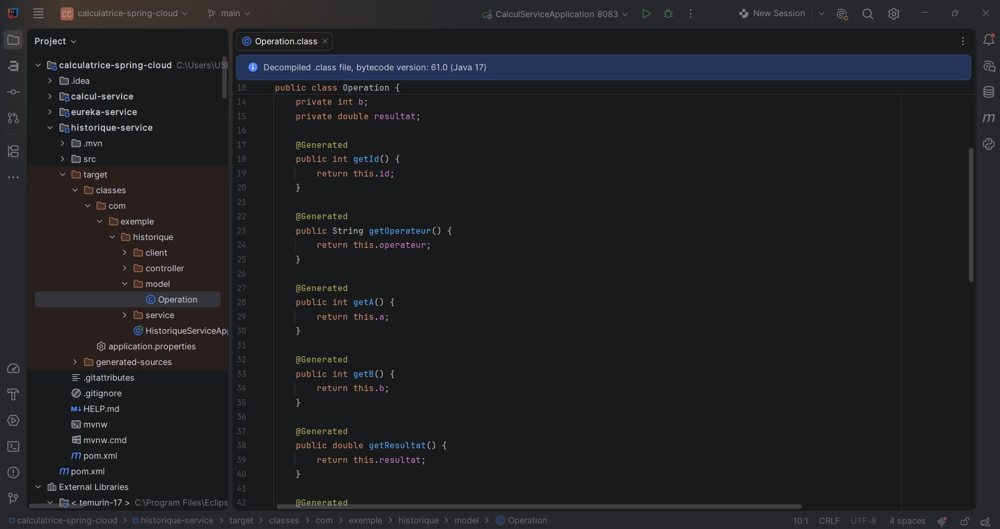<br>
  <em>Figure 11 — <code>Operation.class</code> dans <code>historique-service/target/classes</code>, ouverte dans IntelliJ : la classe décompilée contient <code>getId()</code>, <code>getOperateur()</code>, <code>getA()</code>, <code>getB()</code>, <code>getResultat()</code>… annotés <code>@Generated</code> (bytecode 61.0, Java 17). Ces méthodes n'existent pas dans le code source : elles sont produites par Lombok à la compilation.</em>
</p>

### 9.5 Démarrage et enregistrement

<p align="center">
  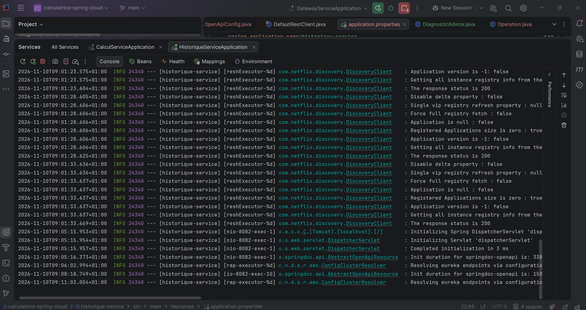<br>
  <em>Figure 12 — Console de <code>historique-service</code> (port 8082) : démarrage et enregistrement auprès d'Eureka. Malgré son nom de fichier, cette capture documente le démarrage du service, non une répartition de charge.</em>
</p>

### 9.6 Tests D.4 — appels **directs** à `historique-service` (port 8082)

Les captures suivantes proviennent du Swagger UI de `historique-service` (`localhost:8082/swagger-ui/index.html`) : la *Request URL* est `http://localhost:8082/operations`. Elles valident la chaîne `historique-service → OpenFeign → calcul-service`, sans la passerelle.

<p align="center">
  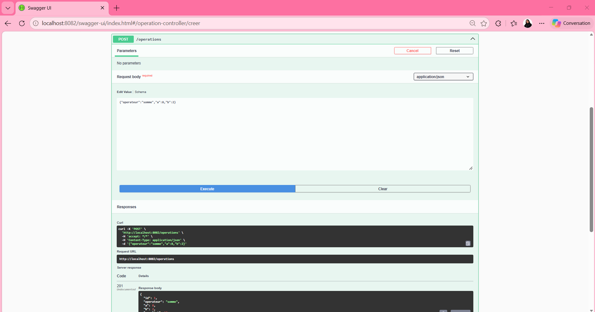<br>
  <em>Figure 13 — Requête 1 : <code>POST /operations</code> <code>{"operateur":"somme","a":8,"b":2}</code> ; réponse HTTP 201. Capture partiellement rognée.</em>
</p>

<p align="center">
  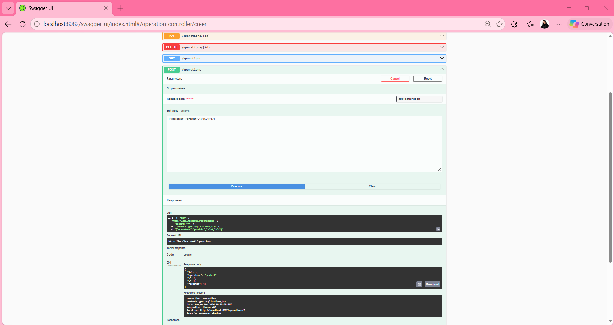<br>
  <em>Figure 14 — Requête 2 : <code>POST /operations</code> produit 6 × 7 ; HTTP 201, <code>id</code> 2, <code>resultat</code> 42, en-tête <code>Location</code> présent.</em>
</p>

<p align="center">
  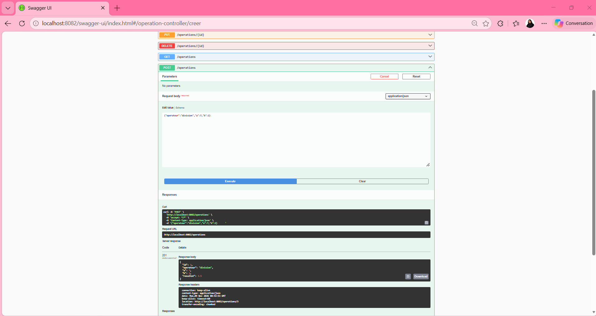<br>
  <em>Figure 15 — Requête 3 : <code>POST /operations</code> <code>{"operateur":"division","a":7,"b":2}</code> ; HTTP <strong>201</strong>, corps <code>{"id":3,"operateur":"division","a":7,"b":2,"resultat":3.5}</code>, en-tête <code>location: http://localhost:8082/operations/3</code> (cohérent avec un appel direct sur le port 8082).</em>
</p>

<p align="center">
  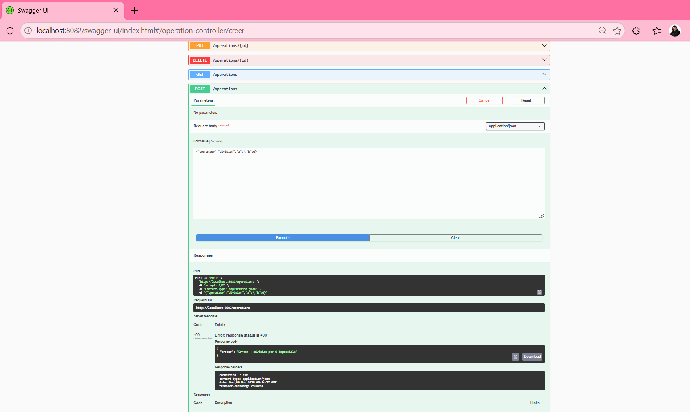<br>
  <em>Figure 16 — Requête 4 : division par zéro (<code>b = 0</code>) ; HTTP <strong>400</strong>, corps <code>{"erreur":"Erreur : division par 0 impossible"}</code>. L'erreur 400 de <code>calcul-service</code> est interceptée par <code>FeignException.BadRequest</code> et son message est transmis (<code>e.contentUTF8()</code>). Swagger signale « Error: response status is 400 ».</em>
</p>

<p align="center">
  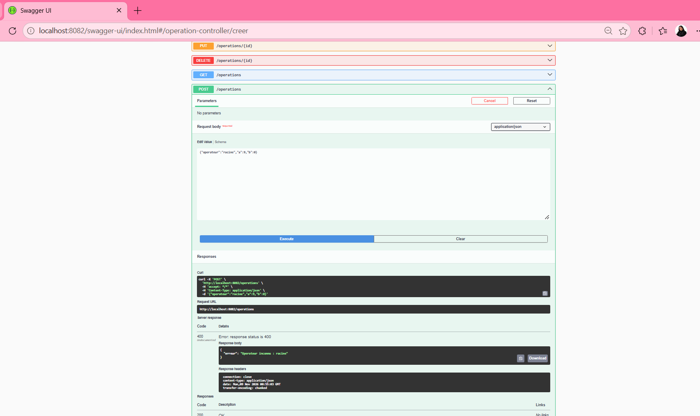<br>
  <em>Figure 17 — Requête 5 : opérateur <code>racine</code> ; HTTP <strong>400</strong>, corps <code>{"erreur":"Operateur inconnu : racine"}</code>. Cette validation s'exécute dans <code>historique-service</code>, avant tout appel à <code>calcul-service</code>.</em>
</p>

<p align="center">
  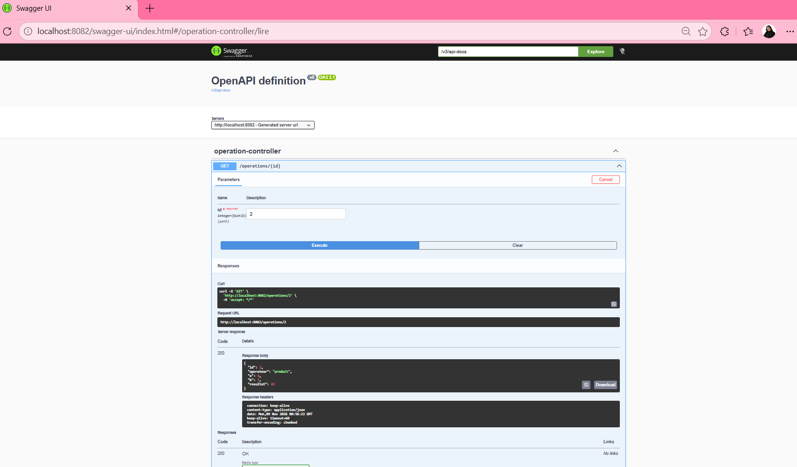<br>
  <em>Figure 18 — Requête 7 : <code>GET /operations/2</code> ; HTTP <strong>200</strong>, corps <code>{"id":2,"operateur":"produit","a":6,"b":7,"resultat":42}</code>. L'opération créée à la requête 2 est bien conservée en mémoire par le service ; le sélecteur « Servers » indique <code>http://localhost:8082</code>.</em>
</p>

**Interprétation.** Les requêtes 1 à 3 prouvent que `historique-service` obtient un résultat de `calcul-service` **sans connaître son adresse** : seule la chaîne `CALCUL-SERVICE` est présente dans le code. Les requêtes 4 et 5 distinguent deux familles d'erreurs : validation locale (opérateur inconnu) et erreur propagée depuis le service appelé (division par 0). La requête 6 (`GET /operations`, liste complète) n'a pas de capture d'exécution en appel direct : la figure 28 montre seulement sa documentation.

---

## 10. La passerelle : routes statiques

### 10.1 Réalisation

`gateway-service` repose sur Spring WebFlux (serveur Netty) ; il n'a donc pas de dépendance `spring-boot-starter-webmvc`. Dépendances : `spring-cloud-starter-gateway-server-webflux`, `spring-cloud-starter-netflix-eureka-client`, `spring-boot-starter-actuator` et `springdoc-openapi-starter-webflux-ui`.

Une route associe un **identifiant**, une **destination** (`uri`) et des **prédicats** ; la requête est transmise telle quelle (`GET :8888/calcul/somme` → `GET <destination>/calcul/somme`). Le préfixe de configuration `spring.cloud.gateway.server.webflux` est celui de la version 5 de Spring Cloud Gateway.

La configuration statique a été conduite en trois variantes équivalentes :

| Étape | Forme | Destination |
|---|---|---|
| E.2 | YAML | adresses fixes (`http://localhost:8081`, `http://localhost:8082`) |
| E.3 | YAML | noms de services avec le schéma `lb://` : `lb://CALCUL-SERVICE`, `lb://HISTORIQUE-SERVICE` |
| E.4 | Java (bean `RouteLocator`) | `lb://…` |

```yaml
spring:
  cloud:
    gateway:
      server:
        webflux:
          routes:
            - id: route-calcul
              uri: lb://CALCUL-SERVICE
              predicates: [ "Path=/calcul/**" ]
            - id: route-historique
              uri: lb://HISTORIQUE-SERVICE
              predicates: [ "Path=/operations/**" ]
            - id: doc-calcul                       # description OpenAPI pour Swagger UI
              uri: lb://CALCUL-SERVICE
              predicates: [ "Path=/docs/calcul" ]
              filters: [ "SetPath=/v3/api-docs" ]
            - id: doc-historique
              uri: lb://HISTORIQUE-SERVICE
              predicates: [ "Path=/docs/historique" ]
              filters: [ "SetPath=/v3/api-docs" ]
```

```java
@Bean
RouteLocator routes(RouteLocatorBuilder builder) {
    return builder.routes()
        .route("route-calcul",      r -> r.path("/calcul/**").uri("lb://CALCUL-SERVICE"))
        .route("route-historique",  r -> r.path("/operations/**").uri("lb://HISTORIQUE-SERVICE"))
        .route("doc-calcul",        r -> r.path("/docs/calcul")
                                          .filters(f -> f.setPath("/v3/api-docs")).uri("lb://CALCUL-SERVICE"))
        .route("doc-historique",    r -> r.path("/docs/historique")
                                          .filters(f -> f.setPath("/v3/api-docs")).uri("lb://HISTORIQUE-SERVICE"))
        .build();
}
```

Les formes YAML et Java sont équivalentes : si les deux coexistent, leurs routes s'ajoutent. Le filtre `SetPath=/v3/api-docs` réécrit le chemin avant transmission (`GET :8888/docs/calcul` → `GET /v3/api-docs` chez le microservice).

### 10.2 Enregistrement de la passerelle

<p align="center">
  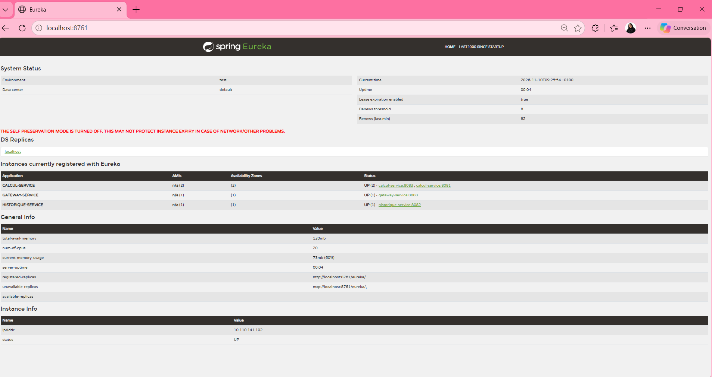<br>
  <em>Figure 19 — Tableau de bord Eureka avec la passerelle lancée : <code>CALCUL-SERVICE</code> UP (2) (ports 8081 et 8083), <code>HISTORIQUE-SERVICE</code> UP (1) (8082) et <code>GATEWAY-SERVICE</code> UP (1) (8888). La passerelle est elle-même cliente de l'annuaire.</em>
</p>

### 10.3 Tests des routes statiques (via le port 8888)

Les requêtes suivantes sont envoyées à la **passerelle** (port 8888) ; le client n'utilise plus les ports 8081 et 8082.

<p align="center">
  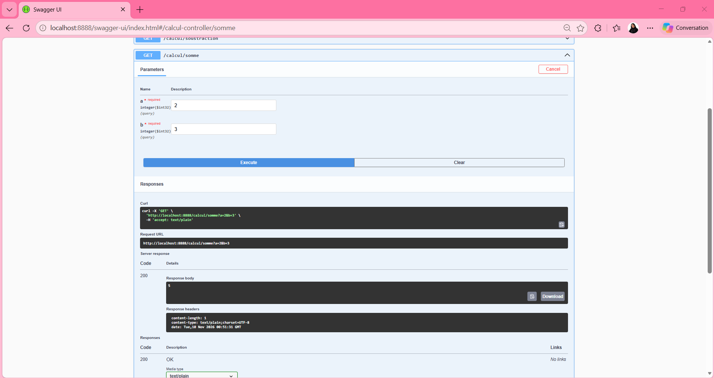<br>
  <em>Figure 20 — <code>GET /calcul/somme?a=2&amp;b=3</code> via la passerelle : HTTP <strong>200</strong>, résultat <strong>5</strong>. Le prédicat <code>Path=/calcul/**</code> a dirigé la requête vers <code>calcul-service</code>.</em>
</p>

<p align="center">
  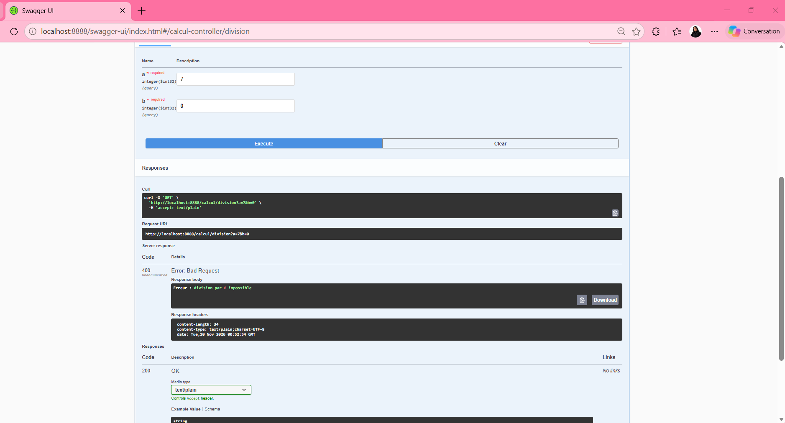<br>
  <em>Figure 21 — <code>GET /calcul/division?a=7&amp;b=0</code> via la passerelle : HTTP <strong>400</strong>. La passerelle relaie fidèlement le statut d'erreur du microservice.</em>
</p>

<p align="center">
  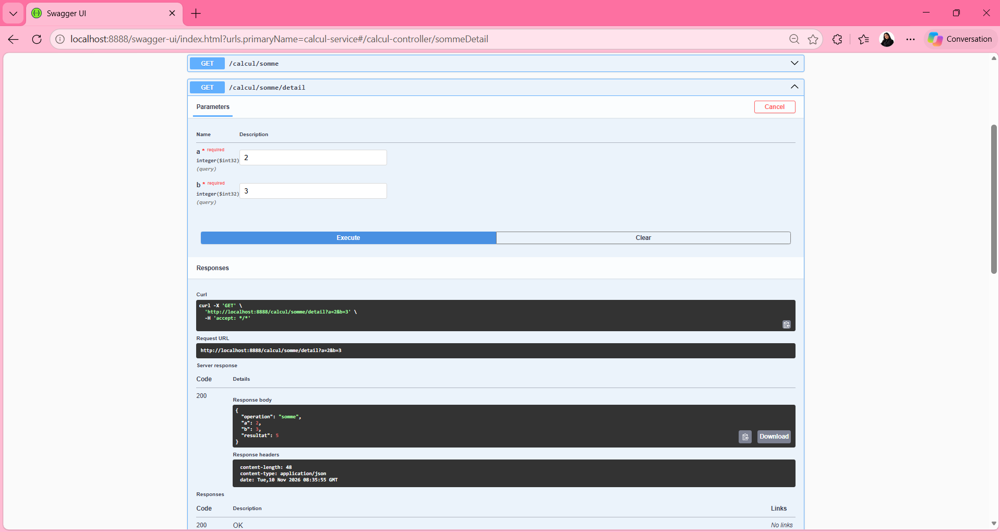<br>
  <em>Figure 22 — <code>GET /calcul/somme/detail?a=2&amp;b=3</code> via la passerelle : HTTP <strong>200</strong>, réponse JSON détaillant l'opération (classe <code>Resultat</code>, générée avec Lombok).</em>
</p>

<p align="center">
  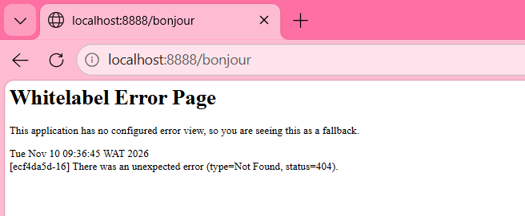<br>
  <em>Figure 23 — <code>http://localhost:8888/bonjour</code> ouvert dans le navigateur : aucune route ne correspond ; la passerelle répond par une <strong>page d'erreur HTML 404</strong> (et non par un document JSON). Ce format est cohérent avec la négociation de contenu : un navigateur envoie <code>Accept: text/html</code>.</em>
</p>

---

## 11. La passerelle : routes dynamiques

### 11.1 Principe et réalisation

Avec dix microservices, écrire dix routes à la main est fastidieux. Le **locator de découverte** crée automatiquement, pour chaque service de l'annuaire nommé `xxx`, la route `Path=/xxx/**` et retire le préfixe `/xxx` avant la transmission.

```yaml
spring:
  cloud:
    gateway:
      server:
        webflux:
          # routes statiques mises en commentaire (E.4)
          discovery:
            locator:
              enabled: true
              lower-case-service-id: true   # noms Eureka (majuscules) acceptés en minuscules dans l'URI
```

Ajouter un microservice ne nécessite alors **aucune modification** de la passerelle. Contrepartie : le nom du service apparaît dans l'URI vue du client (`/calcul-service/calcul/somme`).

| | Statique (E.3) | Dynamique (E.5) |
|---|---|---|
| URI vue du client | `/calcul/somme?a=2&b=3` | `/calcul-service/calcul/somme?a=2&b=3` |
| Nouveau microservice | route à ajouter à la main | route créée automatiquement |
| Nom du service dans l'URI | non | oui |

### 11.2 Tests des routes dynamiques

<p align="center">
  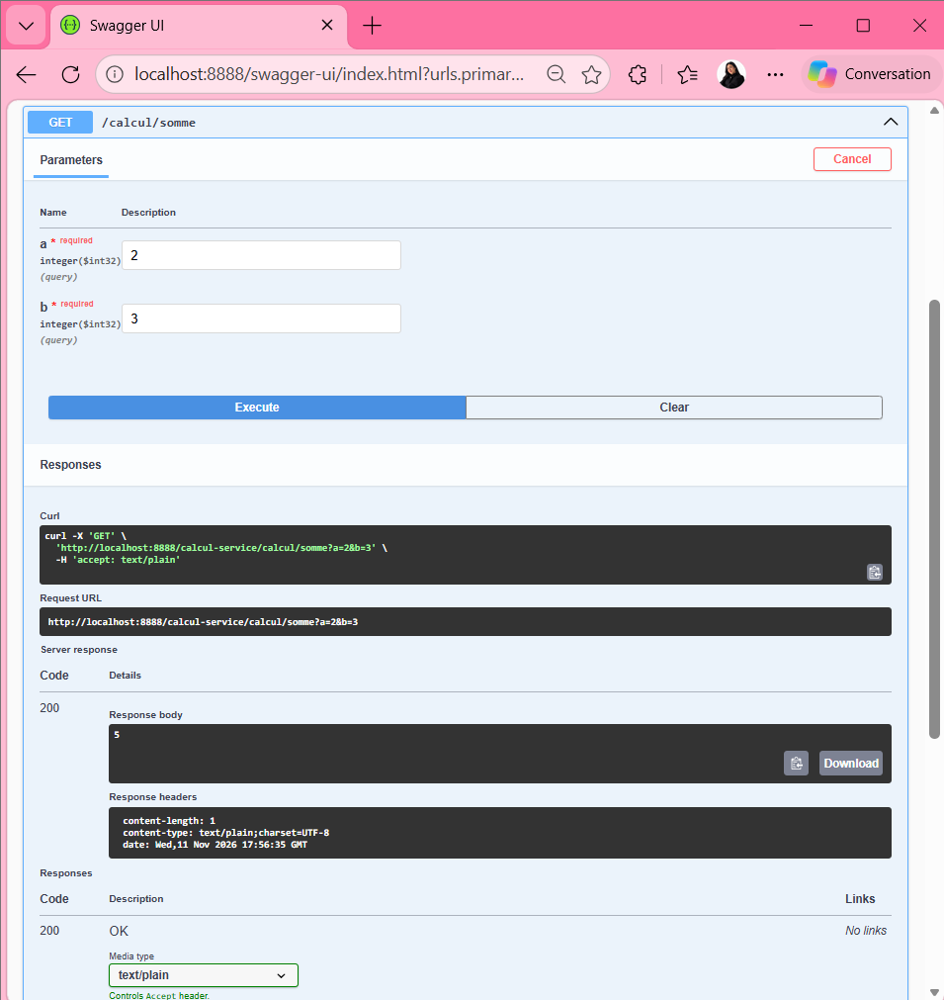<br>
  <em>Figure 24 — <code>GET /calcul-service/calcul/somme?a=2&amp;b=3</code> via la passerelle : résultat <strong>5</strong>. Le préfixe <code>/calcul-service</code> est consommé par la route dynamique, puis <code>GET /calcul/somme</code> est transmis à une instance de <code>CALCUL-SERVICE</code>.</em>
</p>

<p align="center">
  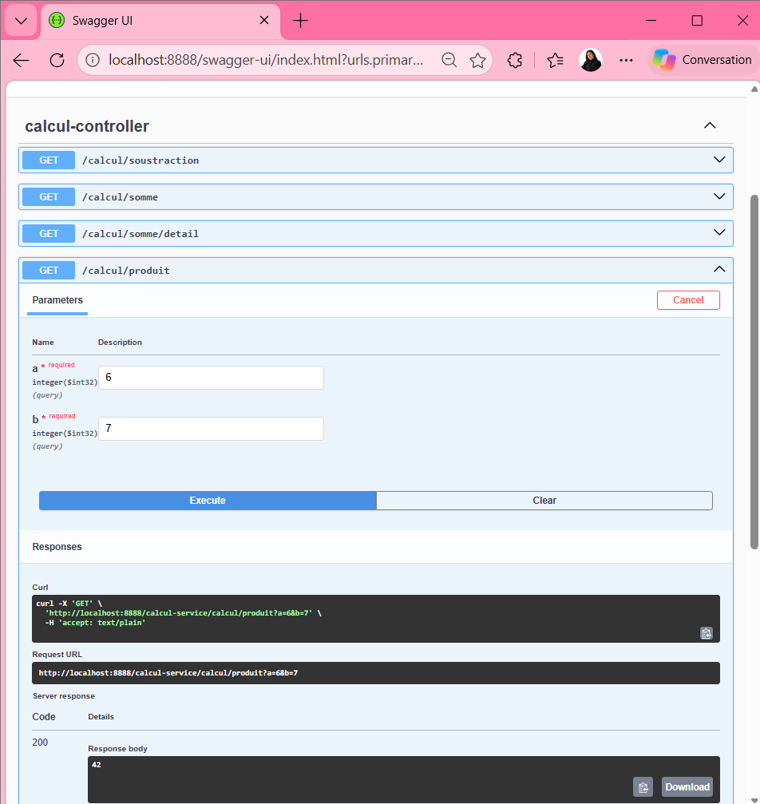<br>
  <em>Figure 25 — <code>GET /calcul-service/calcul/produit…</code> via la passerelle : résultat <strong>42</strong> (6 × 7).</em>
</p>

<p align="center">
  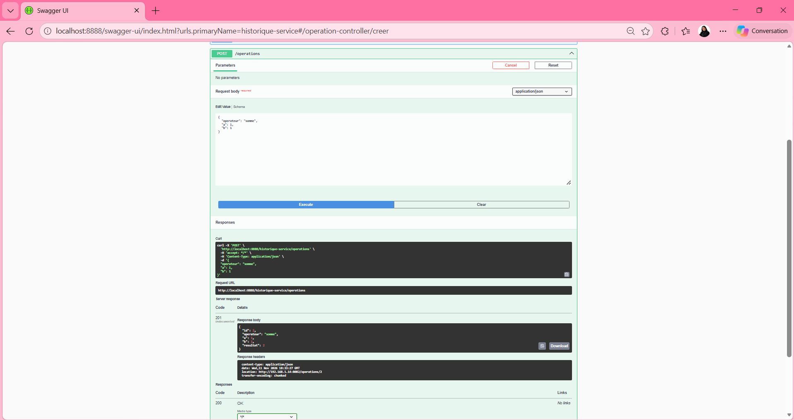<br>
  <em>Figure 26 — <code>POST /historique-service/operations</code> via la passerelle : HTTP <strong>201</strong>, <code>id</code> 2, <code>resultat</code> 2. La requête traverse la passerelle, <code>historique-service</code>, puis OpenFeign vers <code>calcul-service</code>. L'identifiant dépend de l'état en mémoire du service au moment du test (voir <a href="#16-limites-et-points-ouverts">section 16</a> pour l'en-tête <code>Location</code>).</em>
</p>

<p align="center">
  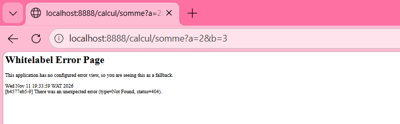<br>
  <em>Figure 27 — <code>http://localhost:8888/calcul/somme?a=2&amp;b=3</code> (sans préfixe) : HTTP <strong>404</strong>. Les routes statiques <code>/calcul/**</code> étant désactivées, seule la forme préfixée par le nom du service est routée : preuve que la configuration active est bien la configuration dynamique.</em>
</p>

---

## 12. Swagger UI et OpenAPI

### 12.1 Principe

`springdoc-openapi` lit les contrôleurs (`@RestController`, `@GetMapping`, `@RequestParam`…) et produit sans code supplémentaire la description OpenAPI (`/v3/api-docs`) et la page d'essai (`/swagger-ui.html`). La version 3.x est celle de Spring Boot 4 ; la passerelle, réactive, utilise la variante `webflux-ui`.

Les contrôleurs sont regroupés sous `operation-controller` (opérations `creer`, `lister`, `lire`, `PUT` et `DELETE /operations/{id}`) et `calcul-controller`. Swagger UI marque les codes 201 et 400 comme « Undocumented » : seuls les codes par défaut sont déclarés (voir perspectives).

<p align="center">
  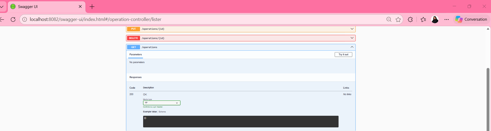<br>
  <em>Figure 28 — Documentation OpenAPI de <code>GET /operations</code> (opération <code>lister</code>) dans Swagger UI de <code>historique-service</code> : paramètres, code de réponse 200, exemple de schéma. Le bouton « Try it out » n'a pas été activé : cette capture illustre la <strong>génération de la documentation</strong>, non l'exécution de la requête.</em>
</p>

### 12.2 Swagger de la passerelle — configuration statique

La page de la passerelle ne contient aucune API propre : elle charge la description OpenAPI de chaque microservice **à travers la passerelle** (`/docs/calcul`, `/docs/historique`), listées dans `springdoc.swagger-ui.urls` (liste *Select a definition*).

Pour que Swagger UI envoie ses requêtes à la passerelle (et non au port du microservice), chaque microservice active `server.forward-headers-strategy=framework` : il reconstruit l'adresse vue par le client à partir des en-têtes `X-Forwarded-Host`, `X-Forwarded-Port` et `X-Forwarded-Prefix` ajoutés par la passerelle.

<p align="center">
  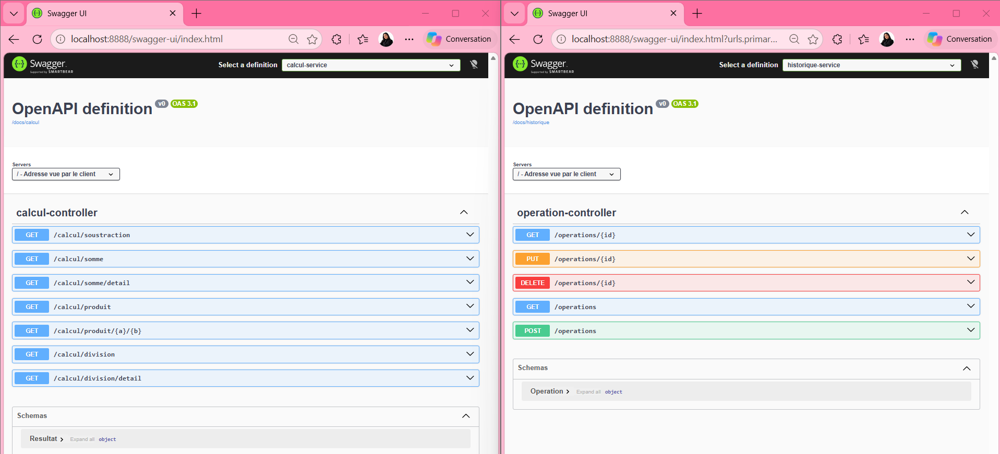<br>
  <em>Figure 29 — Swagger UI de la passerelle en configuration statique : deux définitions (<code>calcul-service</code> et <code>historique-service</code>) ; la zone « Servers » affiche l'adresse du serveur telle que vue par le client, déduite des en-têtes <code>X-Forwarded-*</code>.</em>
</p>

### 12.3 Swagger de la passerelle — configuration dynamique

Les définitions sont lues par les routes dynamiques (`/calcul-service/v3/api-docs`, `/historique-service/v3/api-docs`). Comme la route retire le préfixe, la passerelle ajoute `X-Forwarded-Prefix: /<service>` : la zone « Servers » doit indiquer `http://localhost:8888/<service>`.

<p align="center">
  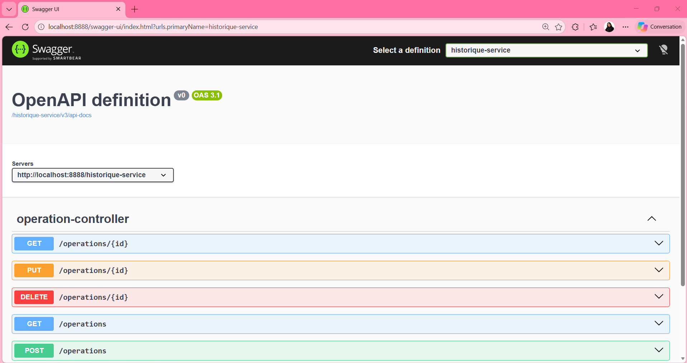<br>
  <em>Figure 30 — Swagger UI de la passerelle en configuration dynamique, définition <code>historique-service</code> : le serveur affiché est <code>http://localhost:8888/historique-service</code>. Chaque « Execute » passe donc par la passerelle, avec le préfixe de service.</em>
</p>

---

## 13. Actuator : observation des routes

La passerelle expose le point d'accès `gateway` d'Actuator (`management.endpoints.web.exposure.include=gateway`) : `GET /actuator/gateway/routes` liste les routes en service.

<p align="center">
  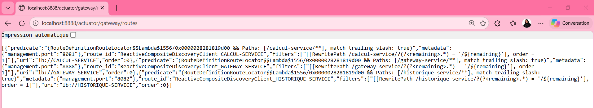<br>
  <em>Figure 31 — <code>/actuator/gateway/routes</code> en configuration dynamique : routes <code>ReactiveCompositeDiscoveryClient_…</code>, une par service de l'annuaire, chacune avec son prédicat <code>Path</code> et son filtre <code>RewritePath</code> qui retire le préfixe. Ces identifiants distinguent les routes issues de la découverte des routes statiques (<code>route-calcul</code>, <code>route-historique</code>, …).</em>
</p>

Les routes suivent l'annuaire : l'arrêt d'un service retire sa route après l'expiration de son bail (≈ 10 s), son redémarrage la recrée. La route de `gateway-service` figure aussi dans la liste : le locator publie tous les services, passerelle comprise, ce qui n'est pas gênant ici mais devrait être filtré ou sécurisé en production (exposition d'Actuator).

---

## 14. Répartition de charge : ce que les captures permettent de conclure

### 14.1 Mécanisme attendu

Deux composants répartissent les appels vers `CALCUL-SERVICE` : Spring Cloud LoadBalancer dans `historique-service` (via OpenFeign) et dans `gateway-service` (via `lb://`). Chacun tient sa propre copie de la liste d'instances et applique, par défaut, un *round robin*. Le rafraîchissement de la liste (`registry-fetch-interval-seconds=5`) et le cache du répartiteur (`cache.ttl=5s`) retardent de quelques secondes la prise en compte d'une nouvelle instance.

### 14.2 Observations

<p align="center">
  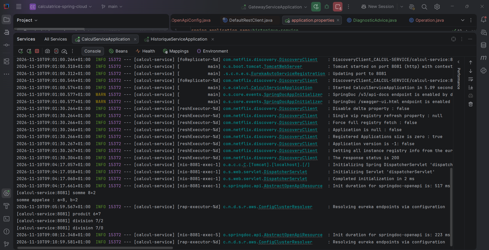<br>
  <em>Figure 32 — Console de l'instance <strong>8081</strong> lors des tests D.4 : traces <code>somme 8+2</code>, <code>produit 6*7</code>, <code>division 7/2</code> et <code>division 7/0</code>.</em>
</p>

<p align="center">
  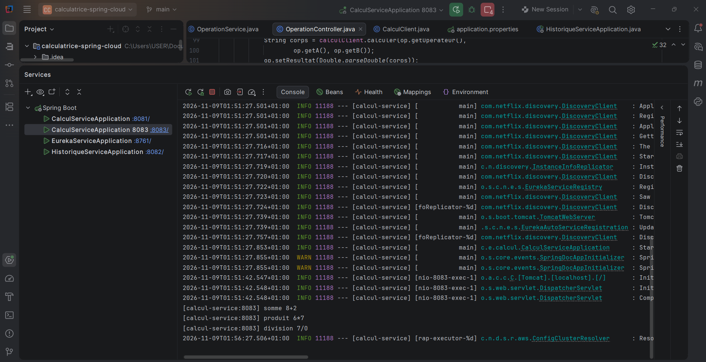<br>
  <em>Figure 33 — Fenêtre <em>Services</em> d'IntelliJ : quatre applications en cours (<code>CalculServiceApplication</code> 8081, <code>CalculServiceApplication 8083</code>, <code>EurekaServiceApplication</code> 8761, <code>HistoriqueServiceApplication</code> 8082 ; la passerelle n'est pas encore lancée). La console affichée est celle de l'instance <strong>8083</strong> : traces <code>[calcul-service:8083] somme 8+2</code>, <code>produit 6*7</code> et <code>division 7/0</code>. Malgré son nom, la capture ne montre que la console 8083.</em>
</p>

<p align="center">
  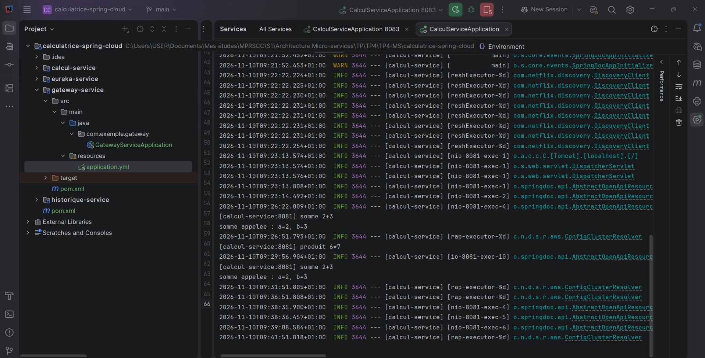<br>
  <em>Figure 34 — Test E.3 (routes <code>lb://</code>), console de l'instance 8081 : plusieurs traces d'opérations somme et produit.</em>
</p>

<p align="center">
  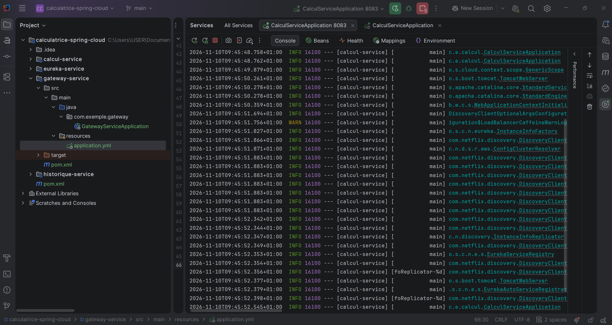<br>
  <em>Figure 35 — Test E.3, console de l'instance 8083 : essentiellement les informations de démarrage.</em>
</p>

### 14.3 Conclusion

- **Établi** : les deux instances sont enregistrées (figure 6), répondent chacune de manière autonome (figures 9 et 10) et ont chacune traité des calculs déclenchés par `historique-service` (figures 32 et 33). Le service est donc effectivement joignable par plusieurs instances.
- **Non établi** : une **alternance régulière** entre 8081 et 8083. La figure 33 montre trois calculs successifs sur 8083 sans la division 7/2 ; les figures 34 et 35 montrent, pour le test E.3, des traces sur 8081 et presque aucune sur 8083. Le répartiteur *round robin* n'est donc **pas démontré** par ces captures.
- **Hypothèses non vérifiées** (pistes d'explication) : chaque appelant (Feign, passerelle) possède son propre compteur ; la nouvelle instance peut ne pas figurer dans la copie locale avant 5 à 10 s ; les consoles agrègent plusieurs séries de tests.
- **Protocole de vérification recommandé** : lancer les deux instances, patienter ≥ 10 s, vider les deux consoles, envoyer six fois `GET /calcul/somme?a=2&b=3` depuis la passerelle, puis relever instance par instance.

---

## 15. Synthèse des validations

| Réf. | Test | Passage par | Résultat observé | Figure |
|---|---|---|---|---|
| Env. | Versions, ports libres | Terminal | Java 17.0.20.1, Git 2.56.0, ports libres | 1 |
| B.5 | Annuaire seul | Navigateur | « No instances available », auto-préservation désactivée | 4 |
| C.4 | Inscription d'une instance | Eureka | `CALCUL-SERVICE` UP (1) | 5 |
| C.4 | `somme` 2+3 | direct 8081 | 5 | 9 |
| C.5 | Deuxième instance | Eureka | `CALCUL-SERVICE` UP (2) | 6 |
| C.5 | `produit` 6×7 | direct 8083 | 42 | 10 |
| C.6 | Arrêt de 8083 | Eureka | instance 8083 DOWN | 7 |
| D.4-1 | POST `somme` 8, 2 | direct 8082 | 201 | 13 |
| D.4-2 | POST `produit` 6, 7 | direct 8082 | 201, `resultat` 42 | 14 |
| D.4-3 | POST `division` 7, 2 | direct 8082 | 201, `resultat` 3.5 | 15 |
| D.4-4 | POST `division` 7, 0 | direct 8082 | 400, `Erreur : division par 0 impossible` | 16 |
| D.4-5 | POST `racine` | direct 8082 | 400, `Operateur inconnu : racine` | 17 |
| D.4-6 | GET `/operations` | direct 8082 | **non exécuté** sur la capture (documentation seule) | 28 |
| D.4-7 | GET `/operations/2` | direct 8082 | 200, produit 6×7 = 42 | 18 |
| E.2-1 | GET `/calcul/somme` | passerelle | 200, 5 | 20 |
| E.2-2 | GET `/calcul/division` b=0 | passerelle | 400 | 21 |
| E.2-5 | GET `/calcul/somme/detail` | passerelle | 200, JSON | 22 |
| E.2-6 | GET `/bonjour` | navigateur | 404, page HTML | 23 |
| E.5-1 | GET `/calcul-service/calcul/somme` | passerelle | 5 | 24 |
| E.5-2 | GET `/calcul-service/calcul/produit` | passerelle | 42 | 25 |
| E.5-4 | POST `/historique-service/operations` | passerelle | 201 | 26 |
| E.5-5 | GET `/calcul/somme` sans préfixe | navigateur | 404 | 27 |
| E.5-6 | `/actuator/gateway/routes` | passerelle | routes `ReactiveCompositeDiscoveryClient_…` | 31 |
| Swagger | Définitions statique / dynamique | Swagger UI | deux définitions ; serveur `…:8888/historique-service` (dynamique) | 29, 30 |
| LB | Alternance 8081/8083 | consoles | **non démontrée** | 32–35 |

---

## 16. Limites et points ouverts

| Point | Constat | Ce qui n'est pas affirmé |
|---|---|---|
| Répartition de charge | Les deux instances reçoivent du trafic ; pas d'alternance visible. | Le fonctionnement du *round robin* n'est pas prouvé (section 14). |
| En-tête `Location` | Pour des appels **directs** (port 8082), `Location` désigne `http://localhost:8082/operations/<id>` (figure 15), ce qui est cohérent. Pour certains POST relevés **via la passerelle**, l'adresse affichée est sur le port 8082. | Aucune capture ne prouve que `Location` soit reconstruit avec l'adresse de la passerelle (8888) grâce aux en-têtes `X-Forwarded-*`. Ce point reste ouvert. |
| `GET /operations` | Documenté (figure 28), non exécuté en appel direct. | Le contenu de la liste n'est pas prouvé en appel direct. |
| Persistance | `historique-service` conserve ses opérations **en mémoire** ; l'identifiant renvoyé dépend du nombre d'opérations déjà créées depuis le démarrage. | — |
| Codes Swagger | Les codes 201 et 400 apparaissent « Undocumented ». | — |
| Configuration | Les extraits de configuration reproduisent la configuration de référence de l'énoncé. | — |

---

## 17. Réponses aux questions du TP

**Partie A.**
1. L'**annuaire Eureka** associe un nom de service à la liste des adresses de ses instances ; la correspondance est mise à jour à chaque inscription, désinscription, battement de cœur ou éviction. Les clients en gardent une copie locale rafraîchie périodiquement.
2. *Avantage* : le client ne connaît qu'une adresse et le routage est centralisé. *Inconvénient* : la passerelle est un point unique de défaillance et ajoute un saut réseau.
3. Avec un tour de rôle strict, chaque instance reçoit **trois** requêtes sur six ; le client ne peut pas s'en apercevoir (réponses identiques).

**B.1.** Chaque programme tourne dans sa propre JVM sur son propre port ; deux processus ne peuvent écouter sur le même port.

**C.1.** Le *nom* (`CALCUL-SERVICE`) sert aux appelants à désigner le service ; l'*identifiant d'instance* (`calcul-service:8081`) distingue chaque exemplaire dans l'annuaire. **C.2.** Sans `--server.port=8083`, la seconde instance viserait le port 8081 déjà occupé et échouerait au démarrage (*réponse théorique, essai non documenté*).

**D.1.** Les instances sont sollicitées à tour de rôle : stratégie **round robin** (*non démontrée par les captures, voir section 14*). **D.2.** Avec un nom de service inexistant, aucune instance n'est trouvée : LoadBalancer répond 503, Feign lève une `FeignException`, attrapée par le **second** `catch`, d'où un 503 `calcul-service injoignable` (*réponse théorique, essai non documenté*).

**E.1.** La passerelle ajoute `X-Forwarded-Host` et `X-Forwarded-Port` ; avec `server.forward-headers-strategy=framework`, `ServletUriComponentsBuilder` s'en sert pour construire l'URL. (*Voir la limite sur `Location` en section 16.*)
**E.2.** En E.3, les URI ne contiennent pas le nom du service, mais chaque nouveau microservice impose une route : c'est E.3 qui oblige à modifier la passerelle. En E.5, les routes sont automatiques, au prix du nom de service dans l'URI.
**E.3.** Le locator crée une route pour tout service inscrit, y compris la passerelle ; sans gravité ici, à filtrer ou sécuriser en production.

**Synthèse.**
1. Correspondances du tableau A.3 : programmes (B, C.5, E.1) ; dépendances (B.2, C.1, C.7, E.1) ; adresse (C.2, C.7, D.2) ; appel inter-services (D.2) ; erreurs (D.3) ; point d'entrée (E.2) ; plusieurs instances (C.5, D.4, E.3) ; serveur embarqué (Tomcat B.5, Netty E.2) ; arrêt d'un service (C.6) ; organisation du code (B.0, C.0) ; outil de test (C.4) ; classes de données (C.1 bis, C.7).
2. `POST :8888/historique-service/operations` : client → passerelle (copie locale de l'annuaire, retrait du préfixe) → `POST /operations` sur 8082 → `calculClient.calculer(...)` → LoadBalancer choisit une instance de `CALCUL-SERVICE` → `GET /calcul/somme?a=1&b=2` sur 8081 ou 8083 → résultat → opération créée (201) → réponse remontée jusqu'au client.
3. Trois programmes embarquent LoadBalancer (avec le client Eureka) ; **deux l'utilisent** : `historique-service` (`CALCUL-SERVICE`) et `gateway-service` (`CALCUL-SERVICE`, `HISTORIQUE-SERVICE`, et tous les services en mode dynamique).
4. Client Eureka : dans les trois ; OpenFeign : `historique-service` seul ; Spring Cloud Gateway : `gateway-service` seul.
5. Une adresse en dur interdit la répartition de charge et la tolérance à la panne ; ici : Eureka, client Eureka, LoadBalancer, OpenFeign et routes `lb://`.
6. Avec deux instances d'`historique-service`, chacune a sa mémoire : un `GET` renvoie une liste partielle selon l'instance ; principe violé : services sans état ; correction : base de données partagée.
7. Voir la [section 6](#6-construction-et-lancement).
8. `@GetMapping` *déclare* une URI reçue dans `CalculController` et *décrit* une requête envoyée dans `CalculClient`.
9. Non : chaque module a sa JVM, son port, son `.jar` et son cycle de vie.
10. L'adresse vient des en-têtes `X-Forwarded-*` (dont `X-Forwarded-Prefix` en E.5) ; sans `forward-headers-strategy=framework`, le microservice annoncerait sa propre adresse et Swagger contournerait la passerelle.
11. Les méthodes générées sont dans le bytecode `Operation.class` (figure 11) ; Lombok n'est pas nécessaire à l'exécution, d'où son exclusion du `.jar`.

---

## 18. Conclusion et perspectives

Ce travail transforme les deux microservices du TP3 en une architecture Spring Cloud cohérente : un annuaire Eureka où s'inscrivent `calcul-service` (deux instances), `historique-service` et la passerelle ; un client OpenFeign qui appelle `CALCUL-SERVICE` par son nom ; une passerelle qui offre un point d'entrée unique en routes statiques puis dynamiques ; une documentation Swagger/OpenAPI par service et par la passerelle ; des classes de données allégées par Lombok. Les captures valident l'inscription et le cycle de vie des instances, la chaîne d'appel `historique-service → calcul-service`, le traitement des erreurs (400, 404) et le routage dynamique par l'annuaire. La répartition de charge entre instances reste **à démontrer** par un relevé de traces dédié (section 14).

**Perspectives** : (1) externaliser l'historique dans une base de données pour rendre `historique-service` sans état ; (2) tolérance aux pannes avec un disjoncteur (Resilience4j) ; (3) documenter les codes 201 et 400 par annotations OpenAPI ; (4) restreindre les routes dynamiques et sécuriser Actuator ; (5) tests automatisés (MockMvc, tests de contrat Feign) ; (6) conteneurisation (Docker Compose) ; (7) traçage distribué (Micrometer Tracing) pour observer la répartition de charge.

---

## Annexe : vue d'ensemble du corpus de captures

Le dossier de captures de ce travail regroupe 46 fichiers : environnement, annuaire, tests directs D.4, tests via la passerelle (E.2, E.5), Swagger, Actuator et consoles. Seules les captures les plus pertinentes sont intégrées ci-dessus, chacune une seule fois ; les séries redondantes ou obsolètes n'ont pas été reprises.

<p align="center">
  <br>
  <em>Figure 36 — Vue d'ensemble du dossier de captures (46 éléments). Cette figure est une illustration générale de l'inventaire ; elle ne constitue la preuve d'aucune fonctionnalité.</em>
</p>
